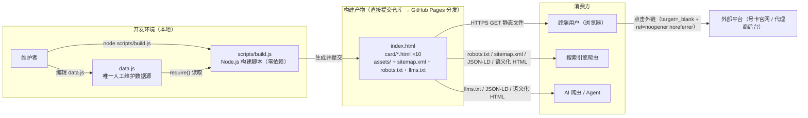
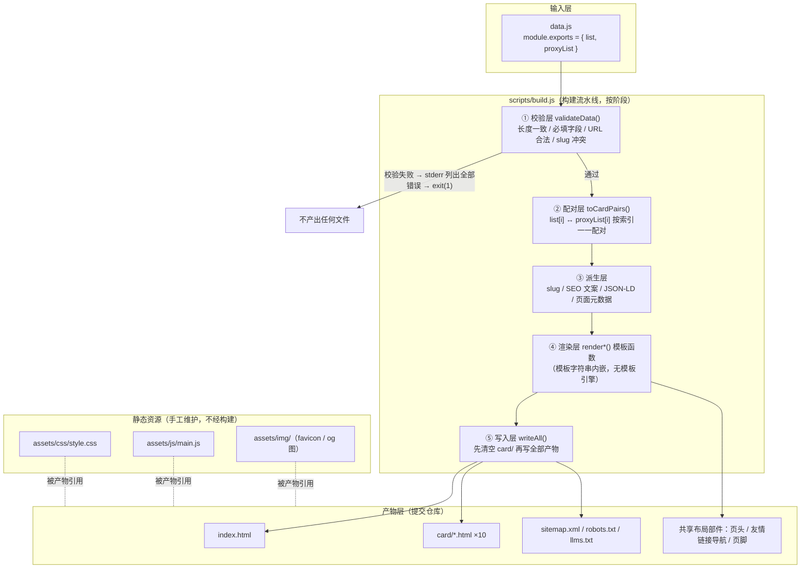
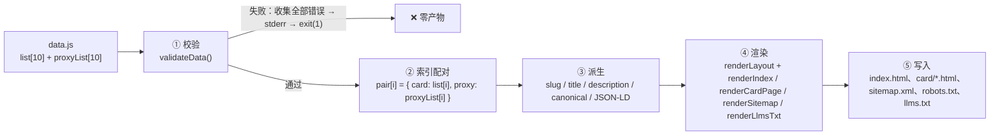

# haoka-site 技术设计文档

> 本文档基于 `.codearts/specs/haoka-site/spec.md`（FR-01~FR-27、NFR-01~NFR-20，共 47 条需求）生成，回答"如何实现"，不新增任何需求。数据源为仓库根目录 `data.js`（10 对号卡/代理链接）。

## 文档信息

| 项 | 值 |
| --- | --- |
| 特性名称 | haoka-site |
| 部署目标 | GitHub Pages（仓库 `haoka17.github.io`，用户站点，站点根 URL：`https://haoka17.github.io/`） |
| 页面规模 | 1 首页 + 10 子页 = 11 个静态页面 |
| 运行时形态 | 纯静态 HTML/CSS/极少量 JS，零后端、零运行时 API 请求 |

---

# **1. 实现模型**

## **1.1 上下文视图**

系统边界与外部参与者：



上下文要点：

- **构建期 / 运行期彻底分离**：所有内容在构建期固化为静态 HTML；页面加载无任何运行时后端请求（对应可靠性/性能 NFR）。
- **GitHub Pages 零构建**：构建产物直接提交仓库，Pages 只做静态文件分发，无需 Actions、无需 Jekyll。
- **单一数据源**：`data.js` 是唯一需要人工编辑的内容文件；新增/修改/删除号卡对后重跑脚本即可完成全站更新（对应可维护性 NFR-10~12）。

## **1.2 服务/组件总体架构**

### 1.2.1 架构结论（先说结论）

**纯静态多页面架构（MPA）+ Node.js 本地构建脚本，零运行时依赖、零第三方依赖。**

- 11 个页面全部由 `scripts/build.js` 在本地生成，产物提交仓库；
- 浏览器只加载原生 HTML + 1 个共享 CSS 文件 + 1 个可选增强 JS；
- 子页数量当前固定为 10，但脚本按数据驱动生成（不硬编码 10），随 `data.js` 自动伸缩。

### 1.2.2 组件架构图



### 1.2.3 目录结构设计

```
haoka17.github.io/                     # GitHub Pages 用户站点（仓库根 = 站点根）
├── data.js                            # ★ 唯一人工维护数据源（10 对号卡/代理）
├── scripts/
│   ├── build.js                       # 构建脚本（Node.js ≥18，零第三方依赖）
│   └── build.test.js                  # 构建逻辑单测（node:test 内置框架）
├── index.html                         # 首页（构建产物，提交仓库）
├── card/                              # 10 个子页（构建产物，构建时先清空重建）
│   ├── dianxin-xingka.html            #   电信星卡
│   ├── 172-haoka.html                 #   172号卡
│   ├── haoka-xinyao.html              #   好卡新耀
│   ├── kaka-tongxin.html              #   咔咔通信
│   ├── dandan-haoka.html              #   蛋蛋号卡
│   ├── lingqu-haoka.html              #   灵渠号卡
│   ├── qinghe-haoka.html              #   青禾号卡
│   ├── haoyi.html                     #   号易
│   ├── kaye-lianmeng.html             #   卡业联盟
│   └── linxi-haoka.html               #   林夕号卡
├── assets/
│   ├── css/
│   │   └── style.css                  # 全站唯一共享样式（含 CSS 变量设计令牌）
│   ├── js/
│   │   └── main.js                    # 渐进增强脚本（卡片入场动画等，可选加载）
│   └── img/
│       ├── favicon.svg                # 站点图标
│       └── og-default.png             # 默认 OG 分享图（1200×630）
├── sitemap.xml                        # 构建产物（11 个 URL）
├── robots.txt                         # 构建产物
├── llms.txt                           # 构建产物（AI 爬虫站点说明）
├── .nojekyll                          # 禁用 GitHub Pages 默认 Jekyll 处理
├── README.md
└── .codearts/
    └── specs/haoka-site/
        ├── spec.md                    # 需求规格（WHAT）
        └── design.md                  # 本文档（HOW）
```

路径规则说明：

- **子页 URL**：`https://haoka17.github.io/card/{slug}.html`，slug 为平台名拼音转写（小写 + 连字符），可读且可直观对应平台名（对应验收项）。
- **静态资源引用**：页面内使用根绝对路径（如 `/assets/css/style.css`）。本仓库为 GitHub Pages **用户站点**，域名根即仓库根，根绝对路径成立且避免 `card/` 子目录相对路径层级问题。

### 1.2.4 技术选型及理由

| 决策点 | 选型 | 理由（对应需求） |
| --- | --- | --- |
| 页面技术 | 原生 HTML5 + CSS3 + 原生 JS（ES2020） | 11 页固定规模、无交互复杂度；满足"单页未压缩 ≤500 KB""无运行时后端请求""LCP ≤ 3s"；框架（Vue/React SPA）会引入运行时与体积，收益为负 |
| 页面生成方式 | Node.js 脚本 `scripts/build.js`，**零第三方依赖**（仅 `node:fs` / `node:path` / `node:url`） | 消除 `npm install` 与 node_modules；任何人 `node scripts/build.js` 即可重建；模板用 JS 模板字符串内嵌，无模板引擎 |
| 备选方案（否决） | ① 手写 11 个 HTML；② Eleventy / Astro 静态站点框架 | ① 11 页重复度高，改一处需同步改 11 处，违背可维护性 NFR-10~12；② 引入 node_modules 构建链与 CI 依赖，违背"产物直接部署 + 零构建配置"要求 |
| 产物策略 | **构建产物提交仓库**（而非 CI 现场构建） | GitHub Pages 无需任何 Actions 配置；任何环境 `git clone` 即得完整可部署站点；产物与 data.js 的对应关系在提交时即确定，可追溯 |
| 样式组织 | 单一共享 `assets/css/style.css`，内含 CSS 自定义属性（设计令牌） | 11 页结构一致，共享单文件避免重复请求与样式漂移；文件 gzip 后远小于预算 |
| 客户端 JS | 渐进增强（卡片入场渐显、当前年份注入），页面完整功能**不依赖 JS** | 可靠性：JS 加载失败时所有链接与内容仍完整可用 |
| slug 生成 | 优先读 `data.js` 条目可选 `slug` 字段 → 回退内置 `SLUG_MAP` 映射表 → 均无则报错 | 零依赖实现中文→可读 slug；现有 10 平台由 SLUG_MAP 固化，未来新增平台在 data.js 新条目里直接写 `slug` 字段即可，仍只改 data.js |
| 构建幂等性 | 每次构建**先清空 `card/` 再全量生成**；内容未变化的文件跳过写入 | 删除号卡对后旧子页自动消失；跳过未变文件减少 git diff 噪音 |

### 1.2.5 数据流设计



**`list[i]` 与 `proxyList[i]` 的配对规则与校验：**

1. **配对依据 = 数组索引**。规范给出的对应关系（电信星卡↔电信星卡代理、172号卡↔172号卡代理、……）恰为"代理名 = 号卡名 + `代理`"且索引同位，因此索引配对是唯一稳定机制。
2. **硬校验（失败即报错，见 1.3.8）**：`list.length === proxyList.length` 且非空；每条必填字段完整；URL 合法。
3. **软校验（仅警告，不阻断）**：若 `proxyList[i].name !== list[i].name + '代理'`，输出 `警告: 第 i 对名称不符合 "{号卡名}代理" 约定（list[i]=…, proxyList[i]=…），请人工确认配对关系`。名称仅作提示，**不作为配对依据**，避免数据方微调命名导致构建失败。
4. 配对结果派生为 `CardPair[]`（数据模型见第 4 章），后续所有页面均从 `CardPair` 渲染，保证首页、子页、友情链接、sitemap、llms.txt 五处数据强一致。

## **1.3 实现设计文档**

### 1.3.1 页面结构设计

所有 11 个页面共享同一布局骨架（由 `renderLayout()` 统一产出），仅 `<main>` 内容区不同：

```
<!DOCTYPE html>
<html lang="zh-CN">
<head>
  charset / viewport / title / description / canonical
  OG + Twitter 卡片标签 / favicon
  <link rel="stylesheet" href="/assets/css/style.css">
  JSON-LD（<script type="application/ld+json">）
</head>
<body>
  <a class="skip-link" href="#main">跳到主要内容</a>   ← 无障碍增强
  <header class="site-header">…</header>
  <main id="main">…（每页不同）…</main>
  <footer class="site-footer">…（含友情链接导航）…</footer>
  <script src="/assets/js/main.js" defer></script>
</body>
</html>
```

#### 首页 `index.html` 线框

```
┌────────────────────────────────────────────────────────────┐
│ <header class="site-header">（吸顶，白底，底部 1px 边框） │
│   <div class="container header-inner">                     │
│     <a class="logo" href="/">⬡ 好卡导航</a>  ← 站名+图标  │
│     <nav aria-label="主导航"> 首页（aria-current=page）</nav>│
│   </div>                                                   │
├────────────────────────────────────────────────────────────┤
│ <main id="main">                                           │
│ ① <section class="hero">（浅色渐变背景）                   │
│     <h1>精选正规号卡平台导航</h1>                          │
│     <p>聚合 10 大正规号卡平台官方办理入口，资费透明，      │
│        另提供各平台代理申请通道</p>                        │
│     <p class="hero-meta">覆盖 10 个平台 · 每月低至 19 元 · 全国可办</p>│
│                                                            │
│ ② <section class="card-section" aria-labelledby="…">       │
│     <h2>号卡平台</h2>                                      │
│     <ul class="card-grid">（CSS Grid，1280px/768px/375px   │
│       分别 3/2/1 列）                                      │
│       ┌──────────┐ ┌──────────┐ ┌──────────┐              │
│       │ 卡片 ×10 │ 每张卡片：                            │
│       │          │  <h3>{平台名}</h3> + badge 角标        │
│       │          │  <p>{description 摘要，2 行截断}</p>    │
│       │          │  <p class="price">{priceRange}</p>     │
│       │          │  <span>{全国通用 | 部分地区}标签</span>│
│       │          │  <a href="card/{slug}.html">查看详情 →</a>│
│       └──────────┘ 整卡可点击进入子页                     │
│     </ul>                                                  │
│                                                            │
│ ③ <section class="proxy-section">（深色/渐变区分区）       │
│     <h2>代理合作入口</h2>                                  │
│     <p>有意成为号卡代理商？直达各平台代理申请通道：</p>    │
│     <ul class="proxy-grid">（桌面 5 列 / 平板 3 / 移动 2） │
│       <li><a 外链>{代理名} ↗</a></li> ×10                 │
│     </ul>                                                  │
│ </main>                                                    │
├────────────────────────────────────────────────────────────┤
│ <footer class="site-footer">（深色底）                     │
│   <nav class="friend-links" aria-label="友情链接">         │
│     首页（当前页→高亮 span） · 电信星卡 · 172号卡 · …      │
│     （11 入口数据源；首页上"首页"排除/高亮，其余 10 链接） │
│   </nav>                                                   │
│   <p class="copyright">© {年} 好卡导航 · 免责声明</p>      │
│ </footer>                                                  │
└────────────────────────────────────────────────────────────┘
```

#### 子页 `card/{slug}.html` 线框（以"电信星卡"为例）

```
┌────────────────────────────────────────────────────────────┐
│ <header>：与首页完全一致（站名可点击回首页）               │
├────────────────────────────────────────────────────────────┤
│ <main id="main">                                           │
│  <section class="card-detail">（白卡片，垂直居中布局）     │
│     <p class="eyebrow">号卡平台</p>                        │
│     <h1>电信星卡</h1>  + badge 角标（如有）                │
│     <ul class="meta-row">                                  │
│       <li>💳 资费：{priceRange}</li>                       │
│       <li>📍 {全国通用 / 部分地区}</li>                    │
│     </ul>                                                  │
│     <p class="desc">{description 全文}</p>                 │
│     <div class="cta-group">（并排两按钮，移动端全宽堆叠）  │
│       <a class="btn btn-primary"   外链>前往号卡平台 ↗</a> │
│       <a class="btn btn-secondary" 外链>申请成为代理 ↗</a> │
│     </div>                                                 │
│     <p class="note">跳转至外部平台，本站不直接售卡</p>     │
│   </section>                                               │
│ </main>                                                    │
├────────────────────────────────────────────────────────────┤
│ <footer>：与首页完全一致；友情链接中"电信星卡"为当前页     │
│   （高亮 span），其余 10 个（首页+9 子页）为可点击链接     │
└────────────────────────────────────────────────────────────┘
```

### 1.3.2 UI 设计规范

**设计基调**：现代、专业、企业官网观感；蓝紫主色调传达"通信/科技/可信"；大量留白 + 卡片化布局。

**配色方案**（定义于 `:root` CSS 变量，全站唯一来源）：

| 令牌 | 色值 | 用途 |
| --- | --- | --- |
| `--color-primary` | `#2563EB` | 主色：链接、主按钮、高亮、logo |
| `--color-primary-hover` | `#1D4ED8` | 主色悬停态 |
| `--color-primary-light` | `#EFF6FF` | 主色浅底：hero 背景、标签底 |
| `--color-accent` | `#7C3AED` | 辅助色：代理区、次级强调 |
| `--color-price` | `#059669` | 价格文字（绿，传达实惠） |
| `--color-bg` | `#F8FAFC` | 页面背景 |
| `--color-surface` | `#FFFFFF` | 卡片表面 |
| `--color-text` | `#0F172A` | 主文字（对比度 ≈ 15:1） |
| `--color-text-secondary` | `#475569` | 次要文字（白底对比度 7.0:1，满足 ≥4.5:1） |
| `--color-border` | `#E2E8F0` | 边框、分割线 |
| `--color-footer-bg` | `#0F172A` | 页脚深色底 |
| `--color-footer-text` | `#94A3B8` | 页脚文字 |
| badge 三色 | 热门 `#B45309` / 新品 `#0E7490` / 四网 `#3B82F6`（白字角标，对比度 5.0 / 5.4 / 3.7 ≥ 3:1，满足 spec NFR-19） | 卡片角标 |

**字体系统**（零 webfont 下载，性能优先）：

```css
font-family: system-ui, -apple-system, "Segoe UI", "PingFang SC",
             "Hiragino Sans GB", "Microsoft YaHei", sans-serif;
```

| 层级 | 规格 |
| --- | --- |
| h1 | `clamp(1.75rem, 4vw, 2.5rem)` / 700 |
| h2 | `clamp(1.25rem, 3vw, 1.5rem)` / 650 |
| h3（卡片标题） | `1.125rem` / 600 |
| 正文 | `1rem`（16px，≥14px ✓）/ 400 / 行高 1.7 |
| 辅助文字 | `0.875rem`（14px） |
| 价格 | `1.25rem` / 700 / `--color-price` |

**卡片样式**：

- 白底、`border-radius: 12px`、`border: 1px solid var(--color-border)`
- 阴影：`0 1px 3px rgba(15, 23, 42, 0.06)`
- 悬停：`transform: translateY(-4px)` + 阴影 `0 12px 24px rgba(37, 99, 235, 0.12)` + 边框 `rgba(37,99,235,.4)`，`transition: all .2s ease`（键盘焦点态 `:focus-visible` 同效）
- badge 角标：绝对定位右上角，圆角胶囊，白字

**按钮样式**：

| 类 | 规格 |
| --- | --- |
| `.btn` 基类 | `display: inline-flex; align-items: center; justify-content: center; min-height: 44px; padding: 12px 24px; border-radius: 8px; font-weight: 600;`（触控目标 ≥44×44 ✓） |
| `.btn-primary` | 主色填充 + 白字；hover 深化 + 轻微上移 |
| `.btn-secondary` | 白底 + 1.5px 主色描边 + 主色字；hover 浅蓝底 |
| 焦点可见性 | `:focus-visible { outline: 2px solid var(--color-primary); outline-offset: 2px; }` |

**间距与容器**：

- 基数 4px，常用阶：8 / 16 / 24 / 32 / 48 / 64
- `.container { max-width: 1152px; margin-inline: auto; padding-inline: 16px; }`（≥768px 时 32px）

**响应式断点**（桌面优先 + max-width 媒体查询）：

| 断点 | 生效条件 | 号卡网格 | 代理网格 |
| --- | --- | --- | --- |
| 桌面 | 默认（≥1024px） | 3 列（1280px 验收 ✓） | 5 列 |
| 平板 | `max-width: 1023px` | 2 列（768px 验收 ✓） | 3 列 |
| 移动 | `max-width: 767px` | 1 列（375px 验收 ✓） | 2 列 |

移动端补充：header 单行自适应；CTA 按钮组 `flex-direction: column` 全宽堆叠；全部布局禁横向滚动（`overflow-x` 校验点）。

### 1.3.3 友情链接模块设计（页脚统一部件）

- **数据源**：11 个入口 = 首页（`/`）+ 10 个子页（`/card/{slug}.html`），全部来自 `CardPair[]`，无硬编码。
- **统一结构**（由 `renderFooterNav(currentSlug)` 产出，11 页复用同一函数）：

```html
<nav class="friend-links" aria-label="友情链接">
  <h2 class="footer-title">友情链接</h2>
  <ul>
    <!-- 非当前页：普通站内链接（同窗口打开） -->
    <li><a href="/">首页</a></li>
    <li><a href="/card/172-haoka.html">172号卡</a></li>
    <!-- 当前页：渲染为非链接文本 + 高亮 + 无障碍语义 -->
    <li><span aria-current="page" class="current">电信星卡</span></li>
    …
  </ul>
</nav>
```

- **当前页处理**：渲染为 `<span aria-current="page">`（排除自身链接 + 高亮样式 `color: var(--color-footer-current); font-weight: 600;`，深色页脚专用高亮蓝 `#60A5FA`，对比度 7.0:1 ≥ 4.5:1 满足 spec NFR-19），既避免自链接，又保留"你在哪一页"的语义。
- **样式**：页脚深色底，链接文字 `--color-footer-text`，hover/聚焦变白 + 下划线；flex wrap 布局，间隔 16px，移动端自动换行。
- **一致性**：11 个页面的页头与友情链接结构完全一致（对应验收项"11 个页面页头与友情链接区域结构一致"），仅"当前页"节点不同。

### 1.3.4 外链处理规范

| 链接类型 | 属性约定 |
| --- | --- |
| 全部 20 个外部链接（10 号卡 + 10 代理） | `<a href="{绝对URL}" target="_blank" rel="noopener noreferrer">`，链接文字后附 `↗` 视觉提示 |
| 站内链接（首页、子页、友情链接、logo） | 相对/根绝对路径，**同窗口**打开，无 target/rel，保持站内浏览连贯 |
| 构建期保障 | `validateData()` 强校验外链 URL 必须是合法 `http(s)://` 绝对地址；渲染层对外链统一注入 `target="_blank" rel="noopener noreferrer"`，不允许遗漏 |

`rel="noopener noreferrer"` 同时满足安全 NFR（防 tab-nabbing、不传递来源信息）。外链不可达不影响站内任何页面渲染（纯静态，无运行时外链探测）。

### 1.3.5 SEO 方案

#### 每页 title / description 生成规则（构建期由模板函数计算，保证 11 页互不重复）

| 页面 | title 模板 | description 模板 |
| --- | --- | --- |
| 首页 | `好卡导航 - 精选正规流量卡/号卡平台导航与代理入口` | `聚合 10 个正规号卡平台官方办理入口与代理申请通道，覆盖电信星卡、172号卡等热门流量卡品牌，附资费区间与适用地区说明，一站比选直达办理。`（固定文案，≤ 160 字符） |
| 子页 | `{平台名}流量卡怎么样？{priceRange}资费详情与办理入口 - 好卡导航` | `{平台名}流量卡资费 {priceRange}，{description 截取前 70 字}。提供官方办理入口与代理申请通道。` |

- 子页 title 以平台名开头 → 天然唯一；description 截取规则：`description.slice(0, 70)` + 固定后缀，总长控制在 160 字符内；构建时断言 11 页 title 与 description 两两去重，重复即报错。
- `{priceRange}` 直接取 data.js 值（如 `19-49元/月`），让搜索结果摘要直接含价格信息。

#### 头部标签全集（每页 `<head>` 固定输出）

```html
<meta charset="UTF-8">
<meta name="viewport" content="width=device-width, initial-scale=1">
<title>…</title>
<meta name="description" content="…">
<meta name="robots" content="index, follow">
<link rel="canonical" href="{页面绝对URL}">
<!-- Open Graph -->
<meta property="og:type" content="website">
<meta property="og:site_name" content="好卡导航">
<meta property="og:locale" content="zh_CN">
<meta property="og:title" content="{同 title}">
<meta property="og:description" content="{同 description}">
<meta property="og:url" content="{页面绝对URL}">
<meta property="og:image" content="https://haoka17.github.io/assets/img/og-default.png">
<!-- Twitter -->
<meta name="twitter:card" content="summary_large_image">
<link rel="icon" href="/assets/img/favicon.svg" type="image/svg+xml">
<link rel="stylesheet" href="/assets/css/style.css">
```

- **canonical**：首页 `https://haoka17.github.io/`，子页 `https://haoka17.github.io/card/{slug}.html`，均为带域名绝对地址。
- 语义化骨架：`header / nav / main / section / footer`，每页**恰一个 h1**，层级 h1→h2→h3 不跳级；全部锚文本有意义（平台名/动作描述，禁止"点这里"）。

#### sitemap.xml 结构（构建产物，11 个 URL）

```xml
<?xml version="1.0" encoding="UTF-8"?>
<urlset xmlns="http://www.sitemaps.org/schemas/sitemap/0.9">
  <url>
    <loc>https://haoka17.github.io/</loc>
    <lastmod>{构建日期，格式 YYYY-MM-DD}</lastmod>
    <changefreq>weekly</changefreq>
    <priority>1.0</priority>
  </url>
  <url>
    <loc>https://haoka17.github.io/card/dianxin-xingka.html</loc>
    <lastmod>{构建日期}</lastmod>
    <changefreq>weekly</changefreq>
    <priority>0.8</priority>
  </url>
  <!-- …共 11 项：首页 + 10 子页，顺序与 data.js 一致 -->
</urlset>
```

构建后自校验：sitemap URL 数量 === 生成的 HTML 文件数（11），且每个 loc 均对应实际存在的产物路径。

#### robots.txt 内容（构建产物，固定文案）

```
User-agent: *
Allow: /

Sitemap: https://haoka17.github.io/sitemap.xml
```

允许全站抓取并显式声明 sitemap 地址（对应验收项）。

#### 其他 SEO 工程要点

- `lang="zh-CN"`、UTF-8 编码全站统一（中文无乱码）；
- `.nojekyll` 提交至仓库根，避免 GitHub Pages 默认 Jekyll 对 `card/` 等目录的额外处理与 `_` 开头文件过滤；
- 页面为纯静态直出 HTML（非 JS 渲染），搜索引擎与 AI 爬虫无需执行 JS 即可获取全部内容。

### 1.3.6 AI 友好方案

#### JSON-LD 结构化数据（每页一段 `<script type="application/ld+json">`，schema.org 词汇）

**首页：`ItemList` + `WebSite`**（`@graph` 联合发布）

```json
{
  "@context": "https://schema.org",
  "@graph": [
    {
      "@type": "WebSite",
      "@id": "https://haoka17.github.io/#website",
      "name": "好卡导航",
      "url": "https://haoka17.github.io/",
      "description": "聚合 10 个正规号卡平台官方办理入口与代理申请通道",
      "inLanguage": "zh-CN"
    },
    {
      "@type": "ItemList",
      "@id": "https://haoka17.github.io/#cardlist",
      "name": "号卡平台列表",
      "itemListOrder": "https://schema.org/ItemListOrderAscending",
      "numberOfItems": 10,
      "itemListElement": [
        {
          "@type": "ListItem",
          "position": 1,
          "name": "电信星卡",
          "url": "https://haoka17.github.io/card/dianxin-xingka.html"
        }
        /* …共 10 项，position 与 data.js 索引一致 */
      ]
    }
  ]
}
```

**子页：`WebPage` + 含两个外链的 `ItemList`**（以电信星卡为例）

```json
{
  "@context": "https://schema.org",
  "@graph": [
    {
      "@type": "WebPage",
      "@id": "https://haoka17.github.io/card/dianxin-xingka.html#webpage",
      "url": "https://haoka17.github.io/card/dianxin-xingka.html",
      "name": "电信星卡流量卡怎么样？19-49元/月资费详情与办理入口",
      "description": "{同 meta description}",
      "inLanguage": "zh-CN",
      "isPartOf": { "@id": "https://haoka17.github.io/#website" },
      "about": { "@type": "Product", "name": "电信星卡流量卡", "offers": { "@type": "AggregateOffer", "priceCurrency": "CNY", "lowPrice": 19, "highPrice": 49, "offerCount": 1 } }
    },
    {
      "@type": "ItemList",
      "name": "电信星卡外部入口",
      "itemListElement": [
        { "@type": "ListItem", "position": 1, "name": "前往电信星卡官方平台", "url": "{list[i].url}" },
        { "@type": "ListItem", "position": 2, "name": "申请成为电信星卡代理", "url": "{proxyList[i].url}" }
      ]
    }
  ]
}
```

- `lowPrice / highPrice` 由构建脚本从 `priceRange`（如 `19-49元/月`）正则提取数字派生；解析失败则省略 `offers` 节点并告警（不影响构建）。
- 全部 JSON-LD 由构建期生成并 `JSON.stringify` 序列化，保证可被 Rich Results Test 解析无错误（对应验收项）。

#### llms.txt 内容结构（构建产物，纯文本 UTF-8）

遵循 llms.txt 社区规范（Markdown 超集）：

```
# 好卡导航

> haoka17.github.io 是一个号卡/流量卡导航站：聚合 10 个正规号卡平台的官方
> 办理入口与代理申请入口，为每个平台提供独立介绍页（资费区间、是否全国
> 通用、平台简介），全部页面纯静态、无需登录、无追踪脚本。

## 站点页面

- [首页 - 号卡平台导航](https://haoka17.github.io/): 10 个号卡平台聚合列表与代理合作入口
- [电信星卡](https://haoka17.github.io/card/dianxin-xingka.html): 资费 19-49元/月，全国通用，官方办理与代理申请入口
- [172号卡](https://haoka17.github.io/card/172-haoka.html): 资费 …，官方办理与代理申请入口
- …（共 11 行，与页面一一对应；子页行 = 平台名 + 资费 + 覆盖范围 + 双入口说明）

## 说明

- 本站为导航站，不直接售卡；所有"办理"与"代理申请"均跳转至外部平台（新标签页打开）。
- 页面数据由 data.js 生成；资费以各外部平台实时展示为准。
```

- 结构固定为：H1 站名 → 引用块站点摘要 → `## 站点页面`（11 行链接清单，每行 = `[名称](URL): 一句话说明`）→ `## 说明`（边界声明）。
- 内容全部从 `CardPair[]` 派生，与页面/ sitemap 强一致。

### 1.3.7 错误与边界处理（构建脚本行为）

**核心原则：fail-fast + 全量收集 + 零半成品产物。** 校验阶段一次性收集全部错误再统一输出；任何校验失败时不写入任何文件（先校验、后渲染、再写入），避免"改了一半的站点"被提交部署。

| # | 场景 | 构建脚本行为 | 退出码 |
| --- | --- | --- | --- |
| E1 | `list` 与 `proxyList` 长度不一致 | `错误: list(N) 与 proxyList(M) 长度不一致，无法按索引一一配对`（N/M 为实际值） | 1 |
| E2 | 数组为空（0 条） | `错误: list/proxyList 为空数组` | 1 |
| E3 | 必填字段缺失/为空（`name` / `url` / `description` / `priceRange`） | `错误: list[3](好卡新耀).priceRange 缺失或为空`——含数组名、索引、平台名（若 name 可用）、字段名，可精确定位 | 1 |
| E4 | `url` 非法（`new URL()` 抛错，或协议非 http/https） | `错误: list[5](蛋蛋号卡).url 非法: "ftp://…"（仅支持 http/https）` | 1 |
| E5 | slug 冲突（两个平台派生出相同 slug，或与保留名 `index` 冲突） | `错误: slug 冲突: "haoka-xinyao" 同时来自 list[2](好卡新耀) 与 …` | 1 |
| E6 | 平台名不在 SLUG_MAP 且未提供 `slug` 字段 | `错误: list[10](新平台) 未提供 slug，且不在内置映射表中；请在 data.js 该条目增加 slug 字段（如 "xin-pingtai"）` | 1 |
| E7 | 代理名不符合 `{号卡名}代理` 约定 | **警告**（不阻断）：`警告: 第 7 对命名不符约定: list=号易 / proxy=号易官方代理` | 0 |
| E8 | `badge` / `nationwide` 缺失 | **降级**：badge 缺失→不渲染角标；nationwide 缺失→不渲染覆盖范围标签（首页摘要与子页 meta 行同步省略） | 0 |
| E9 | `priceRange` 无法解析出 low/high 价格 | **降级**：JSON-LD `offers` 节点省略 + 警告；页面文字仍原样展示 priceRange | 0 |
| E10 | `description` 超长（> 200 字符） | 警告；首页卡片摘要 CSS 截断（`-webkit-line-clamp: 2`），子页展示全文 | 0 |
| E11 | 产物目录写入失败（权限等） | Node 原生错误信息 + 非零退出 | 1 |
| E12 | 校验全过但渲染期异常（模板函数抛错） | 捕获后输出 `错误: 渲染 {页面} 失败: {原因}`；已写入文件全部回滚（写入阶段最后统一落盘前先在内存生成全部内容） | 1 |

实现要点：E1~E6 为"数据契约"级错误，输出到 stderr 并 `process.exit(1)`；E7~E10 为数据质量问题，输出到 stderr 但继续构建（warning 前缀区分）；全部产物字符串先在内存中渲染完成，最后统一写盘，天然保证原子性。

### 1.3.8 可维护性设计（数据变更的改动面）

**目标：内容变更只动 `data.js`，其余全部由构建脚本自动同步。**

| 变更场景 | 需要改动的文件 | 需要执行的操作 |
| --- | --- | --- |
| 修改某平台价格/描述/URL/badge | `data.js`（1 处） | `node scripts/build.js` → 提交 |
| **新增**一个号卡对 | `data.js`：`list` 加 1 条（**建议同时写 `slug` 字段**）+ `proxyList` 加对应 1 条 | 同上；`card/` 新子页自动生成，首页卡片/代理区/友情链接/sitemap/llms.txt/JSON-LD 全部自动包含 |
| **删除**一个号卡对 | `data.js`：两个数组各删 1 条 | 同上；构建时先清空 `card/`，旧子页自动消失 |
| 新增平台且未写 `slug` 字段 | `data.js` + `scripts/build.js`（SLUG_MAP 加 1 行） | 构建（若接受 E6 报错提示的替代路径：直接在 data.js 写 slug，则回到上一行场景） |
| 全站改版（UI/文案/SEO 规则） | `assets/css/style.css` 或 `scripts/build.js` 模板 | 重建 |

自动联动面（改 data.js 后零手工同步）：首页卡片网格与代理入口区、10 个子页内容与双按钮、11 个页面的友情链接导航、sitemap.xml、llms.txt、每页 title/description/canonical/OG、JSON-LD。

### 1.3.9 测试策略概要（供后续测试阶段参考）

#### A. 构建脚本单元测试（`scripts/build.test.js`，node:test 内置框架，`node --test scripts/`）

| 测试点 | 断言要点 |
| --- | --- |
| `validateData()` 契约 | 长度不等 → 报错（E1）；空数组 → 报错（E2）；逐字段缺失 → 报错且信息含索引与字段名（E3）；`ftp://`、非 URL → 报错（E4）；合法数据 → 零错误 |
| `toCardPairs()` 配对 | `pair[i].card === list[i]`、`pair[i].proxy === proxyList[i]`；名称不符约定仅产生警告（E7）不抛错 |
| `slugOf()` | 优先级：条目 `slug` 字段 > SLUG_MAP > 报错（E6）；冲突检测（E5）；现有 10 个平台名 → 期望 slug 快照断言 |
| `badge/nationwide` 可选 | 缺失时正常构建且渲染输出不含对应节点（E8） |
| `renderFooterNav()` | 当前页为 `span[aria-current]`，其余为 `<a>`；入口总数 = 11，链接数 = 10 |
| title/description 唯一性 | 11 页两两去重断言；截断规则（≤160 字符、70 字截取） |
| 外链属性 | 渲染输出中每个 `http(s)://` 外链均含 `target="_blank" rel="noopener noreferrer"` |
| JSON-LD | 每页 `application/ld+json` 内容 `JSON.parse` 不抛错；首页 `ItemList.numberOfItems === 10`；子页含两个外链 ListItem |
| priceRange 解析 | `19-49元/月` → `{low:19, high:49}`；无法解析 → 返回 null + 警告（E9） |

#### B. 构建产物 HTML 结构校验（构建后自检，可作为脚本 `--verify` 步骤或测试阶段脚本）

| 校验点 | 通过标准 |
| --- | --- |
| 文件完整性 | `index.html` + `card/*.html` 数量 === `list.length`；`card/` 无残留旧文件（删除场景） |
| 语义结构 | 11 页均含 `header/nav/main/section/footer`；每页恰一个 `h1`；无标题跳级 |
| SEO 标签 | 每页含 viewport、canonical、description；title/description 全站唯一 |
| sitemap/robots | sitemap `<loc>` 数 === 11 且与产物路径一一对应；robots.txt 含 Sitemap 行 |
| llms.txt | 存在、含 11 个页面 URL、与 sitemap URL 集合一致 |
| 外链安全 | 20 个外链全部含 `rel="noopener noreferrer"` 与 `target="_blank"`；无 `javascript:` 链接 |

#### C. 浏览器端验收测试（后续测试阶段，Playwright，对应 spec 第 7 章验收）

- 响应式：375 / 768 / 1280 三视口下号卡网格列数 1 / 2 / 3，无横向滚动；
- 交互：全站 20 个外链 `target=_blank` 生效；11 页页脚友情链接可互跳且当前页高亮；
- 性能：Lighthouse 移动端 LCP ≤ 3s、无运行时 API 请求（Network 面板仅静态资源）；
- 结构化数据：Rich Results Test 对 11 页解析无错误；
- 编码：页面 UTF-8 中文显示正常（Chrome/Edge/Safari/Firefox 桌面 + 移动）。

---

# **2. 接口设计**

## **2.1 总体设计**

本站无运行时接口。接口设计包含三部分：**URL 路由表**（对外）、**外链跳转约定**（对外）、**构建脚本函数契约**（对内，供开发/测试阶段使用）。

### URL 路由表（全部 11 个页面，构建期固化）

| 路径 | 页面 | title 要点 | JSON-LD 类型 |
| --- | --- | --- | --- |
| `/` | 首页·号卡聚合 | 好卡导航 - 精选正规流量卡/号卡平台导航与代理入口 | WebSite + ItemList |
| `/card/dianxin-xingka.html` | 电信星卡子页 | {平台名}流量卡怎么样？{priceRange}资费详情… | WebPage + ItemList |
| `/card/172-haoka.html` | 172号卡子页 | 同上 | 同上 |
| `/card/haoka-xinyao.html` | 好卡新耀子页 | 同上 | 同上 |
| `/card/kaka-tongxin.html` | 咔咔通信子页 | 同上 | 同上 |
| `/card/dandan-haoka.html` | 蛋蛋号卡子页 | 同上 | 同上 |
| `/card/lingqu-haoka.html` | 灵渠号卡子页 | 同上 | 同上 |
| `/card/qinghe-haoka.html` | 青禾号卡子页 | 同上 | 同上 |
| `/card/haoyi.html` | 号易子页 | 同上 | 同上 |
| `/card/kaye-lianmeng.html` | 卡业联盟子页 | 同上 | 同上 |
| `/card/linxi-haoka.html` | 林夕号卡子页 | 同上 | 同上 |

附属资源路由：`/assets/css/style.css`、`/assets/js/main.js`、`/assets/img/*`、`/sitemap.xml`、`/robots.txt`、`/llms.txt`、`/favicon`（经 `/assets/img/favicon.svg`）。

### 外链跳转约定（20 个外部出口）

| 出口 | 所在页面 | href | 属性 |
| --- | --- | --- | --- |
| 号卡办理链接 `list[i].url` | 首页代理区不含此项**；子页 CTA 主按钮 | 绝对 URL | `target="_blank" rel="noopener noreferrer"` |
| 代理申请链接 `proxyList[i].url` | 首页代理入口区（10 个）；子页 CTA 次按钮 | 绝对 URL | 同上 |

说明：首页承载全部 10 对入口的方式 = 号卡卡片进子页（子页含号卡链接）+ 代理入口区直连 10 个代理外链；即"每一对的两个链接都能从首页 ≤2 次点击到达"。

## **2.2 接口清单（`scripts/build.js` 内部模块契约，JSDoc 类型标注）**

```js
/** 站点级常量（唯一配置来源） */
const SITE = {
  baseUrl: 'https://haoka17.github.io',
  siteName: '好卡导航',
  ogImage: '/assets/img/og-default.png',
};

/**
 * 校验 data.js 数据契约；违反 E1~E6 时收集全部错误后一次性抛出 BuildError。
 * @param {CardItem[]} list
 * @param {ProxyItem[]} proxyList
 * @returns {{errors: string[], warnings: string[]}}
 */
function validateData(list, proxyList) {}

/**
 * 按索引配对并派生页面元数据（slug、pageUrl、title、description、og 等）。
 * @param {CardItem[]} list
 * @param {ProxyItem[]} proxyList
 * @returns {CardPair[]}
 */
function toCardPairs(list, proxyList) {}

/**
 * 解析 priceRange 字符串为价格区间。
 * @param {string} priceRange  形如 "19-49元/月"
 * @returns {{low: number, high: number} | null}  解析失败返回 null（E9 降级）
 */
function parsePriceRange(priceRange) {}

/**
 * 通用布局骨架：head（SEO/OG/JSON-LD）+ header + main + footer。
 * @param {{title: string, description: string, canonicalPath: string,
 *          jsonLd: object, mainHtml: string, currentSlug: string}} page
 * @returns {string} 完整 HTML 文档
 */
function renderLayout(page) {}

/** 渲染首页 main 区（hero + 卡片网格 + 代理入口区）。 @param {CardPair[]} pairs */
function renderIndexMain(pairs) {}

/** 渲染子页 main 区（详情卡 + 双 CTA 按钮）。 @param {CardPair} pair */
function renderCardMain(pair) {}

/** 渲染页脚友情链接导航（11 入口，当前页为高亮 span）。 @param {string} currentSlug */
function renderFooterNav(currentSlug, pairs) {}

/** 生成 sitemap.xml / robots.txt / llms.txt 文本。 */
function renderSitemap(pairs) {}   // → string
function renderRobots() {}         // → string
function renderLlmsTxt(pairs) {}   // → string

/**
 * 主流程：require data.js → 校验 → 配对 → 全量内存渲染 → 清空 card/ → 统一写盘。
 * 失败时 stderr 输出并 process.exit(1)；成功时输出构建摘要（页面数/字节数/警告数）。
 */
function main() {}
```

CLI 契约：`node scripts/build.js`（无必需参数；预留 `--verify` 执行 1.3.9-B 产物自检，供 CI/测试阶段复用）。

---

# **4. 数据模型**

## **4.1 设计目标**

1. **单一数据源**：`data.js` 是唯一人工编辑的内容存储；页面、sitemap、llms.txt、JSON-LD 全部为派生数据，禁止在模板或页面中硬编码平台信息。
2. **构建期类型校验**：JS 为动态语言，通过 JSDoc 显式类型标注 + `validateData()` 在构建期模拟静态契约检查（对应 TypeScript 设计规则：不以 `any` 心智处理数据，所有字段读写前经校验）。
3. **零运行时数据**：`data.js` 不被任何页面引用（浏览器不加载它），产物页面内容 100% 固化，保证性能与可靠性 NFR。
4. **向前兼容扩展**：新增可选字段（如 `slug`）不破坏既有数据；可选字段缺失走降级路径（1.3.7 E8/E9）。

## **4.2 模型实现**

### 源数据模型（data.js 契约，JSDoc 标注于 build.js 顶部）

```js
/**
 * 号卡平台条目（data.js 导出数组 list 的元素）
 * @typedef {Object} CardItem
 * @property {string}  name         平台名，如 "电信星卡"（必填，非空）
 * @property {string}  url          号卡平台官方/办理链接，http(s) 绝对 URL（必填）
 * @property {string}  description  平台简介，50~200 字符（必填，非空）
 * @property {string}  priceRange   资费区间，如 "19-49元/月"（必填，非空）
 * @property {boolean} [nationwide] 是否全国通用（可选；缺省时不渲染覆盖标签）
 * @property {string}  [badge]      角标，枚举值："四网" | "热门" | "新品"（可选；缺省时不渲染角标）
 * @property {string}  [slug]       子页 slug 覆盖值，如 "dianxin-xingka"（可选；
 *                                  缺省时查 SLUG_MAP，仍未命中则构建报错 E6）
 */

/**
 * 代理条目（data.js 导出数组 proxyList 的元素；与 list 按索引一一对应）
 * @typedef {Object} ProxyItem
 * @property {string} name  代理入口名，约定为 "{平台名}代理"（必填，非空）
 * @property {string} url   代理申请链接，http(s) 绝对 URL（必填）
 */
```

### slug 映射表（SLUG_MAP，固化现有 10 个平台）

```js
const SLUG_MAP = {
  '电信星卡': 'dianxin-xingka',
  '172号卡': '172-haoka',
  '好卡新耀': 'haoka-xinyao',
  '咔咔通信': 'kaka-tongxin',
  '蛋蛋号卡': 'dandan-haoka',
  '灵渠号卡': 'lingqu-haoka',
  '青禾号卡': 'qinghe-haoka',
  '号易': 'haoyi',
  '卡业联盟': 'kaye-lianmeng',
  '林夕号卡': 'linxi-haoka',
};
```

### 派生模型 CardPair（配对 + 页面元数据，构建流水线核心中间产物）

```js
/**
 * @typedef {Object} CardPair
 * @property {CardItem}  card          list[i] 原始条目
 * @property {ProxyItem} proxy         proxyList[i] 原始条目（索引配对）
 * @property {string}    slug          经 slugOf() 派生：条目 slug > SLUG_MAP
 * @property {string}    pageUrl       `${SITE.baseUrl}/card/${slug}.html`
 * @property {string}    title         子页 <title>（见 1.3.5 模板）
 * @property {string}    description   子页 meta description（70 字截取规则）
 * @property {{low:number, high:number} | null} price  parsePriceRange() 派生，null 时 JSON-LD 省略 offers
 */
```

### 产物文件模型（一次成功构建的全部输出）

| 产物 | 内容来源 | 生成函数 |
| --- | --- | --- |
| `index.html` | `pairs.reduce` 卡片网格 + 代理区 + 首页 SEO/JSON-LD | `renderLayout` + `renderIndexMain` |
| `card/{slug}.html` ×N | 单个 `CardPair` 详情 + 双 CTA + 子页 SEO/JSON-LD | `renderLayout` + `renderCardMain` |
| `sitemap.xml` | 首页 URL + 全部 `pair.pageUrl` | `renderSitemap` |
| `robots.txt` | 固定文案 + sitemap 地址 | `renderRobots` |
| `llms.txt` | 站点摘要 + 11 入口清单 | `renderLlmsTxt` |

**数据完整性不变式**（构建自检 + 测试阶段断言）：

1. `pairs.length === list.length === proxyList.length`；
2. `new Set(pairs.map(p => p.slug)).size === pairs.length`（slug 唯一）；
3. sitemap 的 URL 集合 === 产物 HTML 的 URL 集合 === llms.txt 列出的 URL 集合；
4. 首页 ItemList 的 `numberOfItems === pairs.length`。

---

## 附：设计决策速览（供评审）

| # | 决策 | 一句话理由 |
| --- | --- | --- |
| D1 | 纯静态 MPA + 零依赖 Node 构建脚本，产物提交仓库 | GitHub Pages 零构建配置，性能与可靠性最优 |
| D2 | `list[i] ↔ proxyList[i]` 索引配对 + 名称软校验 | 索引是唯一稳定配对机制，命名漂移不炸构建 |
| D3 | slug = 条目字段 > SLUG_MAP 兜底 | 零依赖实现可读 URL，新增平台仍可只改 data.js |
| D4 | fail-fast 全量收集错误 + 内存渲染后统一写盘 | 杜绝半成品站点被部署 |
| D5 | 友情链接当前页渲染为 `span[aria-current]` | 排除自链接 + 无障碍位置语义 + 高亮三合一 |
