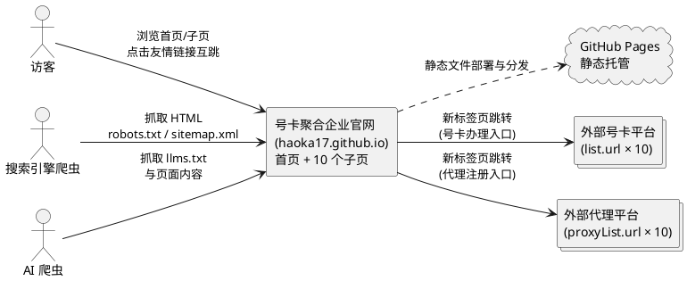
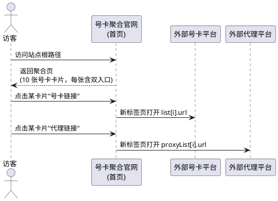
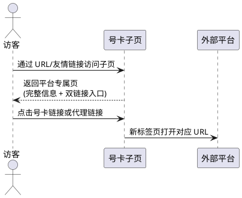
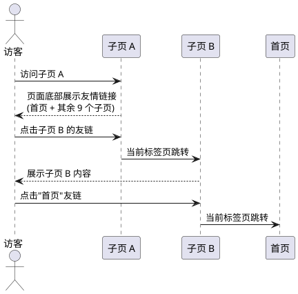
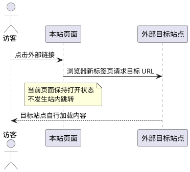
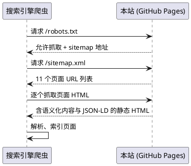
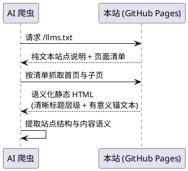

# 号卡聚合企业官网需求规格（spec.md）

| 元信息 | 内容 |
| --- | --- |
| 规格名称 | haoka-site（号卡聚合企业官网） |
| 项目仓库 | haoka17.github.io（GitHub Pages 静态站点） |
| 规格版本 | v1.0 |
| 创建日期 | 2026-10-18 |
| 状态 | 待评审 |
| 需求条目统计 | 功能需求（FR）27 条；非功能需求（NFR）20 条；合计 47 条 EARS 需求 |

> 本文档使用 EARS（Easy Approach to Requirements Syntax）格式书写全部需求条目。触发关键词与固定短语（`When` / `While` / `If` / `Where` / `the system shall`）保留英文，可变部分（事件、前置条件、响应）使用中文表达。

---

# **1. 组件定位**

## **1.1 核心职责**

本组件负责将 10 个外部号卡平台及其对应的代理入口聚合展示为一个企业官网，实现访客浏览、外链跳转、站内互跳，并对搜索引擎与 AI 爬虫提供可理解的结构化内容。

## **1.2 核心输入**

1. **数据源输入**：仓库根目录 `data.js` 文件，包含两个按索引一一对应的数组：
   - `list`（号卡列表，10 条）：每条含 `name`、`url`、`description`、`priceRange`、`nationwide`（布尔）、`badge`
   - `proxyList`（号卡代理列表，10 条）：每条含 `name`、`url`
2. **访客操作指令**：对页面元素的点击（外链跳转、友情链接跳转）与页面滚动浏览。
3. **爬虫抓取请求**：搜索引擎爬虫与 AI 爬虫对站点 URL 的 HTTP GET 请求（含 `robots.txt`、`sitemap.xml`、`llms.txt`）。

## **1.3 核心输出**

1. **静态页面输出**：首页（号卡聚合页）+ 10 个号卡子页，共 11 个可独立访问的 HTML 页面，托管于 GitHub Pages。
2. **对外跳转**：以新标签页方式将访客引导至 10 个外部号卡平台 URL 和 10 个外部代理平台 URL。
3. **爬虫可读文件输出**：`robots.txt`、`sitemap.xml`、`llms.txt`，以及各页面内嵌的 JSON-LD 结构化数据。

## **1.4 职责边界**

本组件**不负责**以下事项：

1. 不负责号卡下单、支付、实名认证等任何交易环节——交易全部发生在外部号卡平台。
2. 不提供任何后端服务（无 API、无数据库、无服务端渲染、无用户系统）。
3. 不负责 `data.js` 中外部 URL 的可达性与内容正确性——外链目标由第三方平台维护。
4. 不采集、存储、上报访客个人信息（无表单、无账号、无埋点追踪）。
5. 不提供站内搜索、筛选、比价、评论等交互功能（首版范围外）。
6. 不负责代理关系的注册审核——代理注册流程全部发生在外部代理平台。

---

# **2. 领域术语**

**号卡平台（list 条目）**
: `data.js` 中 `list` 数组的一个元素，代表一个可供访客办理手机号卡业务的外部平台，含名称、入口链接、描述、价格区间、全国可用标识与徽章。

**代理入口（proxyList 条目）**
: `data.js` 中 `proxyList` 数组的一个元素，代表与某号卡平台对应的代理推广/注册链接，含名称与链接。

**一对链接（链接对）**
: 按索引对应的 `list[i]` 与 `proxyList[i]` 的组合，即同一平台的"号卡链接 + 代理链接"，全站共 10 对。

**首页（聚合页）**
: 站点根路径页面，聚合展示全部 10 个号卡平台的卡片信息与全部 20 个外链入口。

**子页（平台专属页）**
: 为每一对链接单独生成的独立网页，共 10 个，每个子页完整展示单个平台的号卡信息与代理入口。

**友情链接区域**
: 每个页面底部固定的站内导航区域，包含指向首页与其他子页的互跳链接。

**徽章（badge）**
: 号卡平台的短标签文案，如"四网""热门""新品"，用于在卡片上突出平台特征。

**全国可用（nationwide）**
: 布尔标识，为 `true` 时表示该平台支持全国范围办理，页面展示"全国"标识；为 `false` 时不展示该标识。

**价格区间（priceRange）**
: 号卡套餐月费范围文案，格式如"19-49元/月"。

**四网**
: 中国移动、中国联通、中国电信、中国广电四家运营商网络的合称，常见于平台描述与徽章文案。

**llms.txt**
: 放置在站点根目录、面向 AI 爬虫的纯文本说明文件，概述站点目的与全部页面入口。

**JSON-LD 结构化数据**
: 页面内以 `<script type="application/ld+json">` 形式嵌入的机器可读元数据，帮助搜索引擎与 AI 理解页面内容。

**sitemap.xml**
: 列出站点全部可收录 URL 的 XML 文件，供搜索引擎发现首页与 10 个子页。

---

# **3. 角色与边界**

## **3.1 核心角色**

1. **访客**：通过浏览器访问官网的普通用户，浏览号卡平台信息，点击链接跳转至号卡平台或代理平台完成后续操作。
2. **搜索引擎爬虫**：搜索引擎（如 Google、Bing、百度）的自动抓取程序，抓取页面 HTML、`robots.txt`、`sitemap.xml` 以建立索引。
3. **AI 爬虫**：大模型/AI 检索系统的抓取程序，读取 `llms.txt` 与页面内容以理解站点结构。

## **3.2 外部系统**

1. **GitHub Pages**：静态托管平台，负责站点的部署、全球 CDN 分发与 HTTPS 终止。
2. **外部号卡平台（10 个）**：`list` 数组中 `url` 指向的第三方站点（如电信星卡、172号卡等），接收访客办理请求。
3. **外部代理平台（10 个）**：`proxyList` 数组中 `url` 指向的第三方站点（如电信星卡代理、172号卡代理等），接收访客代理注册请求。

## **3.3 交互上下文**

---

# **4. DFX 约束**

## **4.1 性能**

1. **NFR-01（纯静态首屏）**：The system shall 以纯静态资源形式提供全部页面，页面内容加载不依赖任何运行时后端请求。
   - 验收条件：[浏览器开发者工具 Network 面板查看首页加载] → [除静态资源外无任何 API/XHR 请求]
2. **NFR-02（加载速度）**：When 访客在常规宽带网络（≥10 Mbps）下访问任一页面，the system shall 在 3 秒内完成首屏主要内容渲染（LCP ≤ 3s）。
   - 验收条件：[Lighthouse 性能审计移动端模拟] → [LCP ≤ 3s]
3. **NFR-03（资源体积）**：The system shall 单个页面全部静态资源（HTML+CSS+JS+图片，未压缩）总体积不超过 500 KB。
   - 验收条件：[统计单页全部资源字节数] → [总和 ≤ 500 KB]
4. **NFR-04（缓存友好）**：The system shall 使用内容寻址或带版本号的资源引用方式，使重复访问时静态资源可被浏览器与 CDN 有效缓存。
   - 验收条件：[二次加载页面] → [静态资源命中缓存（304/from cache）]

## **4.2 可靠性**

1. **NFR-05（托管可用性）**：The system shall 依托 GitHub Pages 的静态托管能力对外提供服务，不在自有服务器上运行任何进程。
   - 验收条件：[访问 https://haoka17.github.io/ 任意页面] → [由 GitHub Pages CDN 正常返回]
2. **NFR-06（无状态故障隔离）**：If 任一外部号卡平台或代理平台不可达，the system shall 保持自身全部页面正常访问与渲染，不在站内产生任何错误。
   - 验收条件：[模拟某外链目标宕机后访问本站] → [站内 11 个页面均正常展示]

## **4.3 安全性**

1. **NFR-07（HTTPS）**：The system shall 全站通过 HTTPS 对外提供服务，全站资源引用不包含混合内容（http:// 资源）。
   - 验收条件：[浏览器地址栏与控制台检查] → [无"不安全"提示、无混合内容告警]
2. **NFR-08（外链安全属性）**：When 访客点击任一外部链接，the system shall 以 `rel="noopener noreferrer"` 属性打开，防止目标页面获得对来源页面的控制权。
   - 验收条件：[检查全部 20 个外链的 HTML 属性] → [均含 noopener noreferrer]
3. **NFR-09（隐私最小化）**：The system shall 不采集、不存储、不上报访客的任何个人信息，不设置登录态与追踪 Cookie。
   - 验收条件：[访问全站后检查浏览器存储] → [无业务 Cookie、无 localStorage 个人数据写入]

## **4.4 可维护性**

1. **NFR-10（数据与展示分离）**：The system shall 将站点内容数据（`data.js`）与页面模板/结构分离，页面内容由数据驱动生成。
   - 验收条件：[仅修改 data.js 后重新生成] → [11 个页面内容随数据自动更新，无需改动模板]
2. **NFR-11（可扩展性）**：When `data.js` 中新增或删除一对链接数据后执行站点构建，the system shall 自动产出对应数量的子页与更新后的首页、sitemap、友情链接，无需手工修改任何页面文件。
   - 验收条件：[data.js 增加 1 条数据后构建] → [子页数量 +1，首页/sitemap/友链同步包含新条目]
3. **NFR-12（构建产物规范）**：The system shall 构建产物为可直接托管的静态文件目录结构，任何页面可独立于构建工具直接部署到 GitHub Pages。
   - 验收条件：[将构建产物直接推送至 GitHub Pages 分支] → [站点无需额外服务端配置即可访问]

## **4.5 兼容性**

1. **NFR-13（浏览器兼容）**：The system shall 在近两年版本的主流浏览器（Chrome、Edge、Safari、Firefox）的桌面端与移动端上正常展示与跳转，无布局错乱。
   - 验收条件：[跨浏览器/跨设备访问首页与任一子页] → [布局与功能均正常]
2. **NFR-14（编码兼容）**：The system shall 全站页面使用 UTF-8 字符编码，中文内容在任意平台浏览器中无乱码。
   - 验收条件：[检查页面 meta charset 与实际渲染] → [均为 UTF-8 且中文正常显示]

## **4.6 UI/UX 与响应式**

1. **NFR-15（现代专业视觉）**：The system shall 采用现代、专业的企业级视觉风格，具备统一的配色体系、字体层级与间距规范，整体观感与"企业官网"定位一致。
   - 验收条件：[视觉走查首页与子页] → [配色/字体/间距风格统一，无原始默认样式堆砌感]
2. **NFR-16（响应式布局）**：The system shall 对首页号卡卡片列表实现响应式布局：桌面端（≥992px）每行至少 3 列，平板（768–991px）每行 2 列，移动端（<768px）每行 1 列。
   - 验收条件：[分别以 1280px / 768px / 375px 视口宽度访问首页] → [列数分别为 3 / 2 / 1 且无横向滚动条]
3. **NFR-17（移动端触控友好）**：While 访客使用移动设备访问，the system shall 保证全部可点击元素（外链按钮、友情链接）的触控目标尺寸不小于 44×44 像素。
   - 验收条件：[移动端检查各可点击元素尺寸] → [均 ≥ 44×44 px]
4. **NFR-18（交互反馈）**：When 访客的指针悬停或键盘聚焦于任一可点击元素，the system shall 提供明显的视觉反馈（如颜色/阴影/下划线变化）。
   - 验收条件：[hover 与 Tab 键聚焦遍历全部链接] → [每个元素均有可感知的状态变化]
5. **NFR-19（文字可读性）**：The system shall 正文字号不小于 14px，正文文字与背景对比度不低于 4.5:1，徽章等小标签对比度不低于 3:1。
   - 验收条件：[使用对比度检测工具抽查页面文字] → [正文 ≥ 4.5:1，大字/标签 ≥ 3:1]
6. **NFR-20（站内导航一致性）**：The system shall 在全部 11 个页面提供结构一致的页头（站点标识 + 返回首页）与页底（友情链接区域），保持站内导航心智统一。
   - 验收条件：[遍历 11 个页面] → [页头与友情链接区域的结构与位置一致]

---

# **5. 核心能力**

## **5.1 首页号卡聚合展示**

### **5.1.1 业务规则**

1. **FR-01（全量聚合）**：The system shall 在首页聚合展示 `list` 数组中全部号卡平台条目，条目数量与数据源一致（当前为 10 个），一个不漏、一个不重复。
   - 验收条件：[打开首页并统计号卡卡片数量] → [与 data.js 中 list 长度完全一致（10 个）]
2. **FR-02（双入口齐全）**：When 访客浏览首页上任一号卡卡片，the system shall 同时展示该平台的号卡办理入口（`list[i].url`）与代理入口（`proxyList[i].url`）两个可点击链接。
   - 验收条件：[检查首页全部 10 张卡片] → [每张卡片均含号卡链接与代理链接，全站外链入口共 20 个]
3. **FR-03（卡片信息完整）**：When 访客浏览首页任一号卡卡片，the system shall 展示该条目的名称（name）、描述（description）、价格区间（priceRange）与徽章（badge）。
   - 验收条件：[对照 data.js 抽查任意卡片] → [四个字段内容完整渲染且与数据源一致]
4. **FR-04（全国标识展示）**：Where 某号卡条目的 `nationwide` 为 `true`，the system shall 在对应卡片上展示"全国"可办理标识；where `nationwide` 为 `false`，the system shall 不展示该标识。
   - 验收条件：[对照 data.js 中 nationwide 布尔值检查各卡片] → [true 的卡片（如 172号卡、咔咔通信）带"全国"标识，false 的卡片不带]
5. **FR-05（号卡链接跳转）**：When 访客点击首页任一号卡链接，the system shall 在新标签页中打开对应的 `list[i].url` 地址。
   - 验收条件：[点击首页"电信星卡"办理链接] → [新标签页打开 https://ym.ksjhaoka.com/?s=loshqy1H719207]
6. **FR-06（代理链接跳转）**：When 访客点击首页任一代理链接，the system shall 在新标签页中打开对应的 `proxyList[i].url` 地址。
   - 验收条件：[点击首页"电信星卡代理"链接] → [新标签页打开 https://ksjhaoka.com/invite?s=loshqy1H719207]

### **5.1.2 交互流程**

### **5.1.3 异常场景**

1. **外链目标不可达**
   - 触发条件：访客点击的号卡/代理链接指向的外部平台宕机或失效。
   - 系统行为：本站仅负责发起跳转，不检测、不代理外部目标状态；站内页面自身不受影响。
   - 用户感知：新标签页由浏览器展示"无法访问"类提示，本站页面保持正常。

## **5.2 号卡子页生成与展示**

### **5.2.1 业务规则**

1. **FR-07（子页数量与对应关系）**：The system shall 为每一对链接（`list[i]` + `proxyList[i]`）生成一个独立子页，子页总数与数据对数量一致（当前为 10 个）。
   - 验收条件：[统计站点子页数量] → [与 data.js 数据对数量一致（10 个）]
2. **FR-08（子页信息完整）**：When 访客访问任一号卡子页，the system shall 完整展示该平台的名称、描述、价格区间、徽章、全国可用标识（如适用），以及号卡办理链接与代理链接。
   - 验收条件：[访问"电信星卡"子页] → [页面上可见名称、描述、价格区间"19-49元/月"、徽章"四网"，且无"全国"标识；号卡与代理两个链接均可点击]
3. **FR-09（子页链接跳转）**：When 访客在任一子页点击号卡链接或代理链接，the system shall 在新标签页中打开该平台对应的外部 URL。
   - 验收条件：[在"172号卡"子页分别点击两类链接] → [分别在新标签页打开 list[1].url 与 proxyList[1].url]
4. **FR-10（子页独立 URL 与元信息）**：The system shall 为每个子页分配独立的可访问 URL，且各子页拥有互不重复的页面标题（title）与页面描述（meta description），标题中包含对应平台名称。
   - 验收条件：[逐个访问 10 个子页并检查 head 元信息] → [10 个 URL 唯一、10 个 title 互不重复且均含平台名]
5. **FR-11（数据同步）**：When `data.js` 中的数据被修改后执行站点生成流程，the system shall 使全部页面（首页、子页）内容与最新数据保持一致。
   - 验收条件：[临时修改某平台价格区间后重新生成] → [首页与对应子页均展示新价格]

### **5.2.2 交互流程**

### **5.2.3 异常场景**

1. **不存在的子页路径**
   - 触发条件：访客或爬虫请求一个不属于 11 个合法页面（首页 + 10 子页）的路径。
   - 系统行为：由托管平台（GitHub Pages）返回标准 404 页面，不返回空白页或错误内容页。
   - 用户感知：浏览器展示 404 Not Found 响应。

## **5.3 页面底部友情链接互跳**

### **5.3.1 业务规则**

1. **FR-12（友情链接区域）**：The system shall 在全部 11 个页面（首页 + 10 个子页）的底部固定设置"友情链接"区域，作为站内互跳入口。
   - 验收条件：[遍历 11 个页面滚动至底部] → [均存在友情链接区域]
2. **FR-13（子页友链完整性）**：When 访客位于任一子页，the system shall 在友情链接区域展示指向首页的链接和指向其余 9 个子页的链接（共 10 个站内跳转入口）。
   - 验收条件：[在"蛋蛋号卡"子页统计友链] → [含首页链接 + 其余 9 个子页链接，且不包含指向自身的链接]
3. **FR-14（首页友链完整性）**：The system shall 在首页底部友情链接区域展示指向全部 10 个子页的链接。
   - 验收条件：[在首页统计友链] → [10 个子页入口全部存在]
4. **FR-15（友链跳转方式）**：When 访客点击任一友情链接，the system shall 在当前标签页内完成站内页面跳转（非新标签页）。
   - 验收条件：[点击友链后检查] → [当前标签页地址变为目标子页/首页 URL]

### **5.3.2 交互流程**

### **5.3.3 异常场景**

1. **友链目标页缺失（数据变更后）**
   - 触发条件：数据源删除某平台后，历史收藏/外部收录的旧子页 URL 被访问。
   - 系统行为：返回 404；首页与友情链接区域不再包含已删除平台的入口。
   - 用户感知：浏览器 404 页面；可经首页重新到达全部有效页面。

## **5.4 外部链接跳转**

### **5.4.1 业务规则**

1. **FR-16（外链打开方式与安全属性）**：When 访客点击任一外部链接（号卡链接或代理链接），the system shall 在新标签页中打开目标 URL，且链接携带 `rel="noopener noreferrer"` 安全属性。
   - 验收条件：[检查首页与 10 个子页中全部 20×11 个外链的 HTML] → [均为新标签页打开方式且含 rel 安全属性]
2. **FR-17（外链目标准确性）**：The system shall 保证页面上每个外链的 href 与 `data.js` 中对应条目的 `url` 完全一致，不篡改、不截断、不附加额外参数。
   - 验收条件：[抽查含长查询参数的链接（如咔咔通信链接）] → [页面 href 与 data.js 原始值逐字符一致]

### **5.4.2 交互流程**

### **5.4.3 异常场景**

1. **URL 含特殊字符**
   - 触发条件：外链 URL 含 `%`、`&`、`#` 等特殊字符（如好卡新耀、号易的 URL）。
   - 系统行为：链接原样输出，HTML 属性正确转义，不破坏 DOM 结构。
   - 用户感知：点击后正确到达含完整参数的目标页面。

## **5.5 搜索引擎优化（SEO）**

### **5.5.1 业务规则**

1. **FR-18（语义化 HTML）**：The system shall 全部页面使用语义化 HTML 结构组织内容：页头用 `header`、导航用 `nav`、主体用 `main`、内容块用 `section`/`article`、页底用 `footer`。
   - 验收条件：[查看 11 个页面源码] → [均包含上述语义标签且结构合理]
2. **FR-19（唯一元信息）**：The system shall 为每个页面提供互不重复的 `<title>` 与 `<meta name="description">`，并声明 `<meta name="viewport">` 与 `canonical` 链接。
   - 验收条件：[检查 11 个页面 head] → [title/description 均唯一且描述对应页面内容，canonical 指向页面自身规范 URL]
3. **FR-20（sitemap）**：The system shall 在站点根目录提供 `sitemap.xml`，完整列出首页与全部 10 个子页的 URL。
   - 验收条件：[访问 /sitemap.xml] → [包含 11 个 URL，与实际页面一一对应，格式合法可被搜索引擎解析]
4. **FR-21（robots）**：The system shall 在站点根目录提供 `robots.txt`，允许全部爬虫抓取全站，并声明 sitemap 地址。
   - 验收条件：[访问 /robots.txt] → [Allow 全站且含 sitemap.xml 完整 URL]
5. **FR-22（结构化数据）**：The system shall 在每个页面嵌入 JSON-LD 结构化数据：子页描述对应号卡平台信息（如产品/商家类 schema），首页描述站点整体，帮助搜索引擎理解内容实体。
   - 验收条件：[使用 Google Rich Results Test 检测 11 个页面] → [JSON-LD 均可被解析且无错误，内容与页面信息一致]
6. **FR-23（无 JS 渲染依赖）**：While 浏览器或爬虫禁用 JavaScript，the system shall 仍完整展示页面全部核心内容（号卡信息、全部链接、友情链接），核心内容不依赖运行时脚本渲染。
   - 验收条件：[禁用 JS 后访问首页与任一子页] → [卡片信息、20 个外链入口、友情链接区域均完整可见可点击]

### **5.5.2 交互流程**

### **5.5.3 异常场景**

1. **爬虫请求抓取拦截文件缺失**
   - 触发条件：`robots.txt` 或 `sitemap.xml` 因构建遗漏未发布。
   - 系统行为：属于发布阻断缺陷——构建流程应校验两个文件存在，缺失时构建失败并报错。
   - 用户感知：站点构建方收到明确的构建失败提示。

## **5.6 AI 友好**

### **5.6.1 业务规则**

1. **FR-24（llms.txt）**：The system shall 在站点根目录提供 `llms.txt` 纯文本文件，内容包含站点名称与定位说明、首页与全部 10 个子页的标题及链接清单。
   - 验收条件：[访问 /llms.txt] → [以纯文本返回，含站点说明与 11 个页面入口，链接与 sitemap 一致]
2. **FR-25（有意义锚文本）**：The system shall 为全部链接使用描述性的锚文本——外链锚文本包含平台名称（如"电信星卡""电信星卡代理"），友情链接锚文本使用目标页面名称，不使用"点击这里"等无意义文案。
   - 验收条件：[遍历页面全部 `<a>` 元素] → [锚文本均能表明目标内容]
3. **FR-26（可读 URL）**：The system shall 为子页采用包含平台名称信息的可读 URL 路径（如拼音或英文 slug），不使用无意义数字/随机串作为路径。
   - 验收条件：[查看 10 个子页 URL] → [每个路径段可直观对应平台名称]
4. **FR-27（清晰标题层级）**：The system shall 每个页面恰有一个 `<h1>` 主标题（首页为站点主题，子页为平台名称），并按 `h1`→`h2`→`h3` 顺序层级递进，不跳级。
   - 验收条件：[检查 11 个页面标题结构] → [每页 h1 唯一，标题层级无跳级]

### **5.6.2 交互流程**

### **5.6.3 异常场景**

1. **llms.txt 缺失**
   - 触发条件：站点发布时遗漏 `llms.txt`。
   - 系统行为：同 FR-23 异常处理，构建流程校验拦截，构建失败并提示。
   - 用户感知：站点构建方收到明确的构建失败提示。

---

# **6. 数据约束**

## **6.1 号卡条目（list 数组元素）**

1. **name**：必填，非空字符串，为平台对外展示名称（如"电信星卡"），将用于卡片标题、子页 `<h1>`、页面 title 与友情链接锚文本。
2. **url**：必填，合法的外部 http/https URL，为该平台号卡办理入口，页面输出时必须逐字符保持原值（含查询参数与锚点）。
3. **description**：必填，非空字符串，一句话平台描述，将展示于首页卡片与子页正文。
4. **priceRange**：必填，格式为"低-高元/月"的字符串（如"19-49元/月"），表示套餐月费区间。
5. **nationwide**：必填，布尔值；`true` 时页面展示"全国"标识，`false` 时不展示任何全国相关文案。
6. **badge**：必填，非空短文本（如"四网""热门""新品"），展示于卡片显著位置作为特征标签。

## **6.2 代理条目（proxyList 数组元素）**

1. **name**：必填，非空字符串，为代理入口展示名称，命名惯例为"{平台名}代理"（如"电信星卡代理"），与同索引号卡条目语义对应。
2. **url**：必填，合法的外部 http/https URL，为该平台代理注册/推广入口，页面输出时必须逐字符保持原值。

## **6.3 对应关系约束**

1. **数量相等**：`list` 与 `proxyList` 的数组长度必须相等，当前均为 10。
2. **索引对应**：`list[i]` 与 `proxyList[i]` 必须属于同一号卡平台，构成一对链接；全站 10 对数据为：电信星卡、172号卡、好卡新耀、咔咔通信、蛋蛋号卡、灵渠号卡、青禾号卡、号易、卡业联盟、林夕号卡。
3. **数据校验（构建期规则）**：The system shall 在站点生成前对数据源执行校验，If `list` 与 `proxyList` 长度不相等，或任一条目缺少必填字段，或 `url` 不是合法 URL，the system shall 中止生成并输出指明问题条目的错误信息。
   - 验收条件：[临时将 proxyList 减为 9 条后执行构建] → [构建失败并提示两数组长度不一致]

---

# **7. 验收标准**

## **7.1 功能验收场景（Given/When/Then）**

1. **首页聚合完整性**
   - Given data.js 中 list 与 proxyList 各 10 条有效数据，When 访客打开首页，Then 页面展示 10 张号卡卡片，每张卡片含名称、描述、价格区间、徽章及号卡/代理两个链接入口（共 20 个外链）。
2. **全国标识正确性**
   - Given "172号卡"的 nationwide 为 true、"电信星卡"为 false，When 访客打开首页，Then 172号卡卡片展示"全国"标识而电信星卡卡片不展示。
3. **外链跳转正确性**
   - Given 访客位于首页，When 点击"咔咔通信"号卡链接，Then 浏览器在新标签页打开 data.js 中 list[3].url 的完整地址（含全部查询参数），且原页面保持不变。
4. **子页独立存在**
   - Given 站点已生成完成，When 分别访问 10 个子页 URL，Then 每个子页均返回 200，展示对应平台完整信息与双链接，且各子页 title 互不相同。
5. **子页外链跳转**
   - Given 访客位于"号易"子页，When 点击代理链接，Then 新标签页打开 proxyList[7].url。
6. **子页友情链接互跳**
   - Given 访客位于"林夕号卡"子页，When 查看底部友情链接区域，Then 可见首页入口与另外 9 个子页入口（无自身链接）；When 点击"青禾号卡"友链，Then 当前标签页跳转至青禾号卡子页。
7. **首页友情链接**
   - Given 访客位于首页底部，When 查看友情链接区域，Then 10 个子页入口全部可见且点击可达。
8. **无 JS 可用性**
   - Given 浏览器已禁用 JavaScript，When 访客访问首页与任一子页，Then 页面核心内容与全部链接仍完整可见、可点击。
9. **SEO 基础文件**
   - Given 站点已部署，When 访问 /robots.txt、/sitemap.xml，Then 均正常返回；sitemap 包含 11 个 URL 且与实际页面一一对应。
10. **AI 爬虫文件**
    - Given 站点已部署，When 访问 /llms.txt，Then 返回纯文本站点说明及全部 11 个页面入口清单。
11. **数据变更可维护性**
    - Given 仅修改 data.js 中某平台价格区间，When 执行站点生成并部署，Then 首页与该平台子页均展示新价格，其他页面不受影响。

## **7.2 非功能验收检查项清单**

**UI/UX 与响应式**
- [ ] 视口 1280px / 768px / 375px 下首页卡片分别为 3 列 / 2 列 / 1 列，无横向滚动条
- [ ] 全部可点击元素 hover/聚焦有视觉反馈；移动端触控目标 ≥ 44×44 px
- [ ] 全站配色、字体、间距风格统一，具备企业官网的专业观感
- [ ] 正文文字对比度 ≥ 4.5:1，正文字号 ≥ 14px
- [ ] 11 个页面页头与友情链接区域结构一致

**性能与可靠性**
- [ ] Lighthouse 移动端性能审计 LCP ≤ 3s
- [ ] 单页未压缩静态资源总量 ≤ 500 KB；二次访问静态资源命中缓存
- [ ] 页面加载无任何运行时后端 API 请求
- [ ] 任一外链目标不可达时，站内 11 个页面均正常渲染

**安全**
- [ ] 全站 HTTPS，无混合内容
- [ ] 全部外链含 `rel="noopener noreferrer"` 且新标签页打开
- [ ] 无业务 Cookie、无个人信息采集、无追踪脚本

**SEO 与 AI 友好**
- [ ] 11 个页面均含语义化标签（header/nav/main/section/footer）
- [ ] 11 个页面 title、meta description 互不重复，含 viewport 与 canonical
- [ ] 每页恰一个 h1，标题层级无跳级；全部锚文本有意义
- [ ] 10 个子页 URL 为可读 slug（可直观对应平台名）
- [ ] 11 个页面 JSON-LD 可被 Rich Results Test 解析且无错误
- [ ] robots.txt 允许全站抓取并声明 sitemap；sitemap 覆盖全部 11 个 URL
- [ ] llms.txt 存在且包含全部页面入口

**兼容性与工程**
- [ ] Chrome / Edge / Safari / Firefox 桌面端与移动端均正常
- [ ] 页面 UTF-8 编码，中文无乱码
- [ ] 修改 data.js 后重新生成，即可完成全站内容更新（无需改模板）
- [ ] 数据校验失败（数组长度不一致/字段缺失/URL 非法）时构建明确报错
- [ ] 构建产物可直接部署至 GitHub Pages，无需服务端配置

---

## 附录：需求条目索引

| 类别 | 编号区间 | 数量 |
| --- | --- | --- |
| 功能需求（第 5 章） | FR-01 ~ FR-27 | 27 条 |
| 非功能需求（第 4 章） | NFR-01 ~ NFR-20 | 20 条 |
| 合计 | — | 47 条 |

- 首页号卡聚合展示：FR-01 ~ FR-06（6 条）
- 号卡子页生成与展示：FR-07 ~ FR-11（5 条）
- 页面底部友情链接互跳：FR-12 ~ FR-15（4 条）
- 外部链接跳转：FR-16 ~ FR-17（2 条）
- 搜索引擎优化（SEO）：FR-18 ~ FR-23（6 条）
- AI 友好：FR-24 ~ FR-27（4 条）
- 性能：NFR-01 ~ NFR-04（4 条）
- 可靠性：NFR-05 ~ NFR-06（2 条）
- 安全性：NFR-07 ~ NFR-09（3 条）
- 可维护性：NFR-10 ~ NFR-12（3 条）
- 兼容性：NFR-13 ~ NFR-14（2 条）
- UI/UX 与响应式：NFR-15 ~ NFR-20（6 条）
